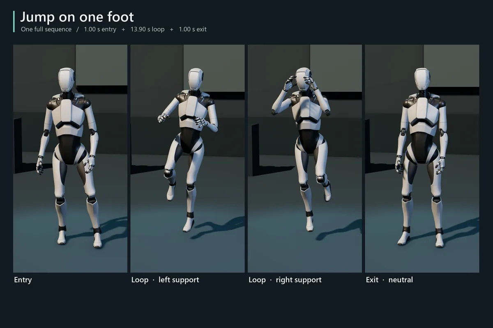

**Fitness Motions: Warmups & Stretches** is a library of full-body exercise
animations for Humanoid characters: a looping **idle** and **15 exercises** —
squats, bends, arm raises and circles, a torso twist, forward and side stretches,
knee to elbow, running in place, jumping jacks, hopping on one foot and boxing.

Every exercise comes as three clips:

- an **Entry** that starts from a shared neutral stance;
- a **Loop** that repeats the exercise seamlessly for as long as you need;
- an **Exit** that returns to the same neutral stance.

Because every Entry starts and every Exit ends on that stance, you can chain
exercises into a workout in any order. The pack also includes a sample character,
a reference Animator controller and an interactive sample scene in a small gym.

It is an animation library, not a gameplay character controller, a terrain-aware
IK system or a fitness coaching application.

## Requirements

- **Unity version:** tested with Unity 6000.0.59f2 and URP 17.0.4.
- **Rig:** Humanoid, with a valid Avatar. The clips rely on Mecanim retargeting,
  so Generic and Legacy rigs are not supported.
- **Render pipeline:** any, for the animations and the controller. The sample
  scene and the sample character's materials are URP — see
  [Render pipelines](#render-pipelines).
- **Sample controls:** mouse and keyboard.

The sample uses Unity's built-in IMGUI and Playables. It needs no Input System,
Cinemachine, TextMeshPro, external character controller or other DevEloop pack.

## Video

- [**Fitness Motions: Warmups & Stretches 2.0.0**](https://youtu.be/GdFY4zKueUQ){:target="_blank" rel="noopener"} —
  all 15 exercises and the idle, played at their original speed.

## The exercises

{: width="1200" height="800"}

Durations are for the clips alone, at speed 1. **Full** is Entry, the loop
repeated a number of times, then Exit — here with one and with three loop cycles.

| # | Exercise | Entry, s | Loop, s | Exit, s | Full, 1 cycle, s | Full, 3 cycles, s |
|---|---|---:|---:|---:|---:|---:|
| 01 | `Idle` | — | 20.000 | — | 20.000 | — |
| 02 | `Squats` | 1.000 | 2.367 | 1.000 | 4.367 | 9.100 |
| 03 | `BendForward` | 1.000 | 2.700 | 1.000 | 4.700 | 10.100 |
| 04 | `BendSide` | 1.000 | 7.033 | 1.000 | 9.033 | 23.100 |
| 05 | `BendToFeet` | 1.000 | 7.567 | 1.000 | 9.567 | 24.700 |
| 06 | `ArmsUp` | 1.000 | 3.333 | 1.000 | 5.333 | 12.000 |
| 07 | `RotateArms` | 1.000 | 9.433 | 1.000 | 11.433 | 30.300 |
| 08 | `TwistBody` | 2.600 | 2.833 | 3.533 | 8.967 | 14.633 |
| 09 | `StretchForward` | 1.000 | 1.933 | 1.000 | 3.933 | 7.800 |
| 10 | `StretchSide` | 1.000 | 11.267 | 1.000 | 13.267 | 35.800 |
| 11 | `TurnAndStretch` | 1.000 | 4.100 | 1.000 | 6.100 | 14.300 |
| 12 | `StandKneeToElbow` | 1.000 | 2.100 | 1.000 | 4.100 | 8.300 |
| 13 | `RunInPlace` | 1.000 | 5.800 | 1.000 | 7.800 | 19.400 |
| 14 | `JumpingJacks` | 1.000 | 6.533 | 1.000 | 8.533 | 21.600 |
| 15 | `JumpOnOneFoot` | 1.000 | 13.900 | 1.000 | 15.900 | 43.700 |
| 16 | `Boxing` | 1.000 | 7.033 | 1.000 | 9.033 | 23.100 |

One loop cycle can contain several movements: `JumpingJacks` contains six jacks,
`JumpOnOneFoot` hops on both supporting legs in turn, and `RunInPlace` is a
series of alternating steps. Repeating a loop repeats the whole cycle, not a
single step or jump.

`Idle` is one 20-second loop with no Entry or Exit; it starts and ends on the
neutral stance. In `Boxing` the fingers close during Entry, stay clenched through
the Loop and open during Exit, and the body turns as it punches.

### The clips

There are **47 FBX files** in `Animations/`, one clip per file, and each clip has
the same name as its file:

- `<Exercise>_Entry`, `<Exercise>_Loop` and `<Exercise>_Exit` for the 15
  exercises — 45 clips;
- `Idle_Loop`;
- `Common_Neutral`, a one-frame reference of the shared neutral stance. It is a
  pose for checking alignment, not an exercise.

All clips are Humanoid. Loops are imported with **Loop Time** on; entries and
exits are one-shot. Most clips are sampled at 120 FPS; `StandKneeToElbow` and
`TurnAndStretch_Loop` use 240 FPS, and `Idle_Loop` and `Common_Neutral` use 30
FPS. The sampling rate doesn't change their speed or duration.

## What is in the package

Everything lives under `Assets/DevEloop/FitnessMotions_Warmups&Stretches/`:

| Folder | Contents |
|---|---|
| `Animations/` | The 47 FBX files and `warmups_and_stretches_controller.controller` |
| `Character/` | The sample character — model, prefab, three URP materials, textures |
| `Samples/` | `FitnessLibrary.unity`, its gym materials, scripts and optional URP settings |
| `Documentation/` | The animation catalogue and the integration guide |
| `AI/Skills/` | Three skills for AI coding assistants |

The animation importers copy their Avatar from `Character/Models/Model.fbx`, so
keep `Character/` together with `Animations/` even if you don't use the sample
character.

## Try the sample first

Open `Samples/FitnessLibrary.unity` and press Play. Select an exercise in the list
on the left, or type in the search field to filter by name.

{: width="1200" height="800"}

By default a preview plays **Full**: Entry, three loop cycles, Exit, then holds
the neutral stance. The readout under the preview shows the time and which part
is playing.

| Control | Action |
|---|---|
| Select a row | Play that exercise from the start |
| **Play** / **Pause** / Space | Pause or resume |
| **Replay** / R | Return to the start, keeping the play or pause state |
| Timeline | Drag to seek; the preview pauses there and **Play** resumes from it |
| Speed (**1x**) | Cycle through 0.25×, 0.5×, 1×, 1.5× and 2× |
| **Camera** | **Front**, **Side**, **Back** or **3/4** — moves the camera, never the character |
| Right-drag / middle-drag / wheel | Orbit / pan / zoom over the preview |
| F | Reset the view |

**Options** holds the rest:

| Option | What it does |
|---|---|
| **Full** / **Entry** / **Loop** / **Exit** | Play the whole sequence or one part on its own |
| **Loop cycles** | 1, 3 or 5 loop cycles in **Full**; 3 by default |
| **Repeat** | Repeat the selected sequence or part instead of stopping |
| **Auto sequence** | Play all 16 exercises one after another |
| **+1 frame** | Step forward one frame of the clip |
| **Show neutral stance** | Pause on the shared neutral pose |

For `Idle`, the part buttons and **Loop cycles** are disabled — it has no Entry
or Exit.

**Auto sequence** visits every exercise, even when the search filter hides some
of them. Selecting a row, seeking, choosing a part or stepping a frame turns it
off. **Repeat** and **Auto sequence** can't be on at the same time. Keyboard
shortcuts don't work while you are typing in the search field.

### Try your own character

1. Import your model as **Humanoid** and check that its Avatar is valid.
2. Duplicate `FitnessLibrary.unity` and add your character's prefab to the copy.
3. Select the object named **Fitness Library - assign Character here** and drag
   your character's Animator into **Character** on the `FitnessLibrary`
   component.
4. Disable the sample character and press Play.

Set this up before entering Play mode. Keep the character at uniform scale, with
its feet on the ground at Y = 0. A character with different proportions may not
plant its feet exactly like the sample one — check the contacts and adjust the
Avatar, or add your own IK, if needed.

## Use the animations on a character

### Build a sequence in your own controller

Expand an FBX in the Project window to reach its clip, and drag the clips into
your Animator Controller. The full pattern for one exercise is:

`Idle_Loop → <Exercise>_Entry → <Exercise>_Loop (N cycles) → <Exercise>_Exit → Idle_Loop`

{: width="1200" height="800"}

For a sequence that runs by itself, use these transitions. All of them have
**Has Exit Time** on, **Transition Duration** 0 and **Transition Offset** 0, and
every state has speed 1:

| Transition | Exit Time |
|---|---:|
| Entry → Loop | 1 |
| Loop → Exit | N — the number of loop cycles; `3` plays three |
| Exit → Idle, or Exit → the next Entry | 1 |

The zero-length transitions are deliberate. Entry ends exactly where the Loop
begins, and the Exit ends exactly on the neutral stance where the next Entry, or
the idle, begins — so the poses meet without a blend.

To start an exercise from gameplay, give **Idle → Entry** a condition on your own
trigger and keep the rest on exit time.

Don't jump from the middle of one exercise straight into another and expect the
poses to match. Let the Exit finish, or author a blend that suits your
application. Crossfading over an Entry or an Exit changes the foot contacts.

### The reference controller

`Animations/warmups_and_stretches_controller.controller` is a working example of
those transitions. It has **no parameters**: assign it to a Humanoid character's
Animator and press Play. It starts in `Idle`, plays all 15 exercises one after
another — Entry, three loop cycles, Exit — returns to `Idle` and starts over.
Every exercise-to-exercise transition uses the timings above.

## Root motion and foot contact

The character's translation and rotation are baked into the Humanoid pose, so the
GameObject doesn't travel from one cycle to the next — the exercises stay on the
spot. Local movement of the body and feet is still there, especially in `Boxing`,
which steps and turns as it punches.

Let one system own the character's movement. Additional root movement, gravity,
procedural aiming, foot IK or body constraints all change the poses; test without
them first. Foot contact was checked on the included character standing at Y = 0
with unit scale.

## Render pipelines

The animations and the controller work in every render pipeline. Only the sample
scene and the sample character's materials are URP; Built-in and HDRP versions
are not supplied. Your own character needs materials for your project's pipeline.

Your existing URP pipeline is fine for the sample. For the look it was set up
with — 8× MSAA and soft shadows — you can assign
`Samples/Settings/SamplePipeline.asset` in **Project Settings → Graphics** and
check the pipeline overrides under **Quality**, which take precedence.
`Samples/Settings/StudioVolume.asset` adds ACES tonemapping and color
adjustments. This is optional and changes how your whole project renders;
importing the package or playing the sample never changes your pipeline or
project settings by itself.

## Sample scripts

The four scripts in `Samples/Scripts/`, in the `DevEloop.FitnessMotions.Samples`
assembly, exist only for the sample scene. The animations and the reference
controller need none of them.

| Script | What it does |
|---|---|
| `FitnessLibrary` | The exercise list, Auto sequence and swapping in your character |
| `FitnessPanel` | The library interface: search, playback controls, timeline and options (IMGUI) |
| `FitnessOrbitCamera` | Orbit, pan, zoom, the camera presets and the shortcuts; reads IMGUI events, so it needs no input package |
| `AnimationTestPlayer` | Plays Entry, Loop and Exit through a PlayableGraph, with seeking, speed and frame stepping |

`AnimationTestPlayer` owns the character's Animator while it is enabled and
restores its previous controller, root-motion and culling settings when it is
disabled. Don't assign another controller or graph to the same Animator while the
preview is running. These scripts are sample utilities, not a production
character-controller API.

## Upgrading from 1.0.0

Version 2.0.0 replaces the animation set with a new, refined library, and the
separate sample scenes with a single `Samples/FitnessLibrary.unity`.

1. Back up your project first.
2. The character asset and controller GUIDs are unchanged, and the controller
   now uses the new clips.
3. The 1.0.0 animation FBX files are not part of 2.0.0, but Unity doesn't remove
   files from an earlier import. Your own references keep playing the old
   motions until you reassign them to the new clips.
4. Once nothing references them, delete the old animation files and the old
   sample scenes.

The sample materials are now URP.

## Troubleshooting

| Symptom | Check |
|---|---|
| The sample character or floor is pink | Use URP and check the pipeline set in **Graphics** and **Quality**. Import the whole `Character/` and `Samples/` folders |
| The character stays in a T-pose | The Humanoid Avatar, the controller and the clip references; look for missing references in the Console |
| Feet float or slide on another character | The Avatar mapping, scale and proportions, and any script that also moves the character or applies IK. The sample character is the reference; retargeting doesn't guarantee identical contacts on every rig |
| The character moves unexpectedly | The root is baked into the pose, and `Boxing` steps and turns on purpose. Don't add a second movement correction on top |
| **Full** takes longer than expected | A loop cycle can contain several steps or jumps, and **Full** repeats the whole cycle — see [the exercises](#the-exercises) |
| Warnings about keyboard input or the Input System | The sample reads IMGUI events and needs neither the Input System package nor legacy input axes |
| Keyboard shortcuts don't respond | Leave the search field and click into the Game view |

## Skills for AI coding assistants

Three skills ship inside the package, under
`Assets/DevEloop/FitnessMotions_Warmups&Stretches/AI/Skills/`. Each is a plain
`SKILL.md` that describes one part of the pack in the terms an assistant needs to
act on it — the real clip names, durations and transition values rather than
plausible guesses.

| Skill | Covers |
|---|---|
| `fitness-motions-warmups-stretches-setup-and-overview` | Checking the install, the exercise catalogue, setting up the URP sample |
| `fitness-motions-warmups-stretches-preview` | Sample playback, seeking to a pose, previewing your own character |
| `fitness-motions-warmups-stretches-sequences` | Joining Entry, Loop and Exit in an Animator, checking cycle boundaries |

Point your assistant at that folder, or copy the skills to wherever it reads them
from. They are ordinary Markdown, depend on no particular tool, and make no
runtime AI connection or data collection.

## Support

Questions, bug reports and suggestions are welcome. Include your **Unity** and
**URP versions**, the scene or clip name, any Console message, the steps to
reproduce, and whether it also happens with the sample character.

<dev.eloop@outlook.com>
