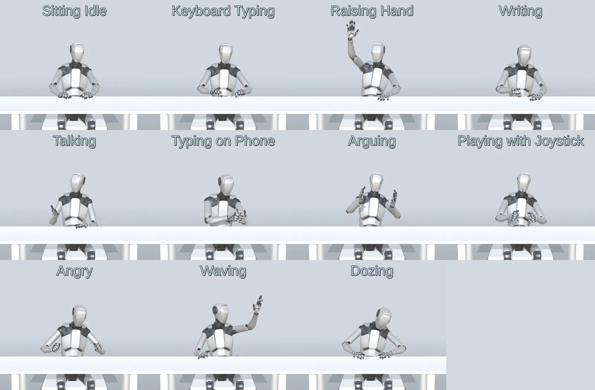

**Sitting Animations Pack** is 11 full-body animations of a Humanoid character
seated at a desk: an idle, keyboard typing, writing, talking, typing on a phone,
arguing, playing with a joystick, anger, waving, raising a hand and dozing off.
They suit offices, classrooms, control rooms, meetings and dialogue scenes.

The animations were captured on Meta Quest with
[Animation Recorder](/animation-recorder/docs/), and the **fingers are animated**
too — the hands actually type, write and hold a phone instead of staying in a
fixed pose.

The pack also includes a sample character, an Animator controller that plays
every animation in turn, and a sample scene. It needs no scripts.

## Requirements

- **Unity version:** 2022.3 or newer.
- **Rig:** Humanoid, with a valid Avatar. The clips rely on Mecanim retargeting,
  so generic and legacy rigs are not supported.
- **Render pipeline:** any, for the animations and the controller. The sample
  scene and the sample character's materials use the Built-in Render Pipeline —
  see [Render pipelines](#render-pipelines) for URP and HDRP.

## Video

- [**Sitting Animations Pack**](https://youtu.be/5o4r5oQmaw8){:target="_blank" rel="noopener"} —
  every animation on the sample character.

## The animations

{: width="1600" height="1050"}

Each animation is a separate FBX file under `Animations/`, imported as Humanoid
with one clip. Durations are for the clip alone, at speed 1.

| File | Animation | Duration, s | Loop | What it does |
|---|---|---:|:---:|---|
| `sitting_idle.fbx` | Sitting Idle | 20.8 | Yes | A natural seated idle with subtle movement |
| `keyboard_typing.fbx` | Keyboard Typing | 26.6 | | Focused, fast typing on a keyboard |
| `writing.fbx` | Writing | 19.2 | | Taking notes on a sheet of paper |
| `talking.fbx` | Talking | 32.1 | | Conversation with arm gestures |
| `phone_typing.fbx` | Typing on Phone | 19.2 | | Typing or texting on a smartphone |
| `arguing.fbx` | Arguing | 11.2 | | Expressive frustration and disagreement |
| `joystick_playing.fbx` | Playing with Joystick | 15.1 | | Casual gaming with a joystick |
| `angry.fbx` | Angry | 5.4 | | A burst of anger with strong gestures |
| `waving.fbx` | Waving | 4.1 | | A friendly wave while seated |
| `hand_rising.fbx` | Raising Hand | 5.0 | | Raising a hand, as in a classroom or meeting |
| `dozing.fbx` | Dozing | 17.7 | | Nodding off at the desk |
| `sitting_idle_short.fbx` | Sitting Idle, short | 10.0 | | A shorter idle that opens the sample sequence |

Only `sitting_idle` loops as imported; the others play once and hold their last
frame. To repeat one — keyboard typing in a long office shot, say — select its FBX,
open the **Animation** tab of the import settings, tick **Loop Time** and click
**Apply**. Unity's loop-match indicators there show how closely the first and last
poses agree; where they differ, a short crossfade back into the same state hides
the jump better than a hard loop.

## What is in the package

Everything lives under `Assets/DevEloop/SittingAnimationsPack/`:

| Folder | Contents |
|---|---|
| `Animations/` | The 12 FBX files and `sitting_animator_controller.controller` |
| `Character/` | The sample character — model, prefab, materials and textures |
| `Materials/` | Table and floor materials for the sample scene |
| `Scenes/` | `SittingAnimationsSample.unity` and its lighting data |

Every animation FBX also contains the sample character's mesh, so a clip can be
previewed on its own in the Inspector, or opened in Blender, Maya or another 3D
application with the character attached. The Avatar is copied from the sample
character.

## Try the sample first

Open `Scenes/SittingAnimationsSample.unity` and press Play. The sample character
sits at a table and plays every animation in turn, ending in the looping sitting
idle.

The sequence comes from `sitting_animator_controller`:

`sitting_idle_short` → `keyboard_typing` → `hand_rising` → `writing` →
`talking` → `phone_typing` → `arguing` → `joystick_playing` → `angry` →
`waving` → `dozing` → `sitting_idle`

Each step moves on by exit time with a 0.25 s crossfade. The controller has no
parameters — it is a showcase, not a controller to drive a character from code.

## Use the animations on a character

1. Make sure your model is imported as **Humanoid** — model import settings →
   **Rig** → **Animation Type: Humanoid** → **Apply**.
2. Create an **Animator Controller**, or open your own, and drag the FBX files
   you need into it. Each one becomes a state with its clip.
3. Set the default state — usually `sitting_idle` — and add transitions between
   the states, driven by your own parameters.
4. Assign the controller to the **Animator** on your character.

To start from the sample's states instead, duplicate
`sitting_animator_controller`, delete the transitions you do not want and add
your own. Do not edit the original — a package update would overwrite it.

The clips also work without a controller: drag one onto an **Animation Track**
in Timeline for a cutscene.

### Chairs and desks

The animations sit the character at the height of the sample chair and reach for
the sample table. In your scene:

- **Seat height** — position the chair, or the character, so the hips rest on the
  seat. A character much taller or shorter than the sample one changes where the
  hips end up.
- **Desk height and distance** — move the desk so the hands land on it in the
  typing and writing animations. If several characters share one desk model, check
  the pose with the tallest and the shortest of them.
- **Props** — the pack contains no keyboard, pen, phone or joystick. Parent your
  prop to the hand bone, or place it where the hands meet it.

## Render pipelines

The animations and the controller work in every render pipeline. Only the sample
scene and the sample character's materials use the Built-in **Standard** shader,
and they show pink in URP or HDRP until converted:

- **Built-in** — works as is.
- **URP** — **Window → Rendering → Render Pipeline Converter** → **Built-in to
  URP** → tick **Material Upgrade** → **Initialize And Convert**. Or select the
  materials in `Character/Materials` and `Materials` and switch their shader to
  **Universal Render Pipeline/Lit**.
- **HDRP** — switch the same materials to **HDRP/Lit** and assign the textures
  from `Character/Textures`.

## Troubleshooting

| Problem | Cause and fix |
|---|---|
| The character does not move | The model is not Humanoid, or the Animator has no Avatar. Set **Animation Type: Humanoid** in the model's **Rig** tab. |
| An animation stops and freezes | It is not set to loop. Tick **Loop Time** on its FBX — see [The animations](#the-animations). |
| The character floats above the chair or sinks into it | The seat is at a different height from the sample's. Move the chair or the character. |
| Hands pass through the desk or hover above it | Move the desk; the hand positions match the sample table. |
| The sample scene is pink | The materials are Built-in Standard. Convert them — see [Render pipelines](#render-pipelines). |

## Support

Questions, bug reports and suggestions are welcome. Include your **Unity
version**, your **render pipeline** and which animation you are using.

<dev.eloop@outlook.com>
